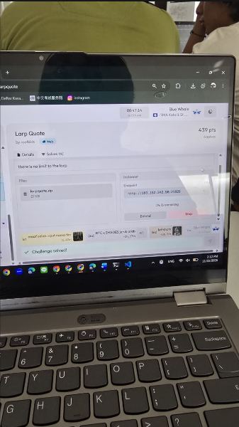
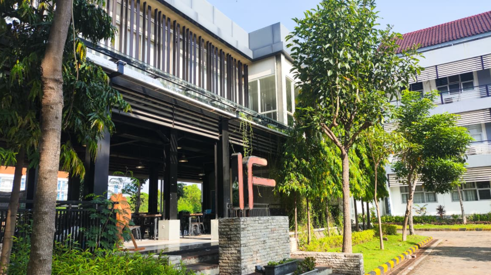

# 100DaysOfCode Twitter/X Challenge Round 5 (START: 22 November 2026, Sunday)
# Quote of This Round still the same: "Life is like riding a bicycle. To keep your balance, you must keep moving." -Albert Einstein.

#100DaysOfCode
R5D0:
- Busy competing onsite CTF jeopardy Finals competition today. It's incredibly hard, extremely hard for me.
- And also I write Write-Up for today's CTF competition.
- I have no idea for new round of 100DaysOfCode challenge lol.

#100DaysOfCode
R5D1:
- Today's week is an end-of-term exam week at my school
- So busy studying for end-term  exams tomorrow. Honestly, I got procrastinated a bit a lot.
- So sleepy and so exhausted right now for me.

#100DaysOfCode
R5D2:
- This week is an end-of-term exam week at my school, so I am busy studying for end-of-term exams tomorrow.
- Just showed up today by researching a CTF competition on Instagram. Or maybe I should research beyond just on IG.

#100DaysOfCode
R5D3:
- This week is an end-of-term exam week at my school.
- I am so busy studying or "cramming" for a tough end-of-term physics exam tomorrow. No way I can pass wkwkwkwk.
- Just showed up today by still doing researching a CTF competition on IG.

