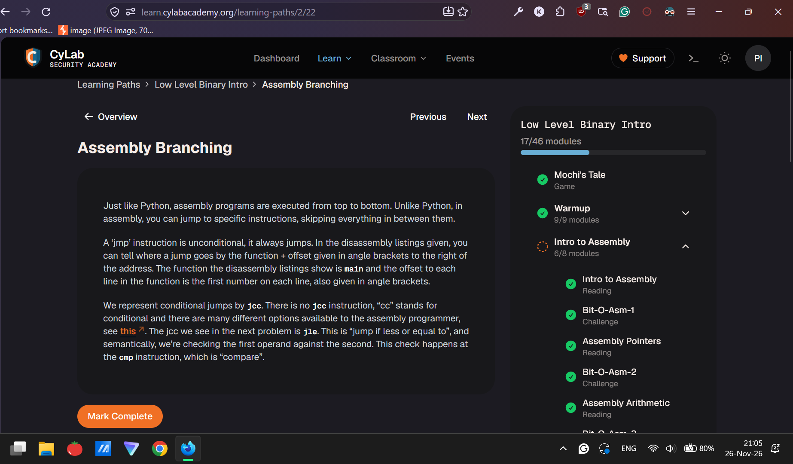
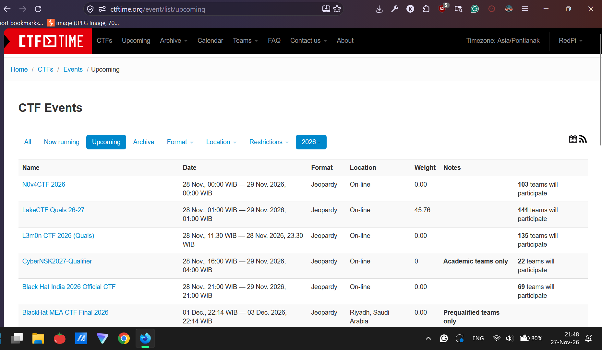
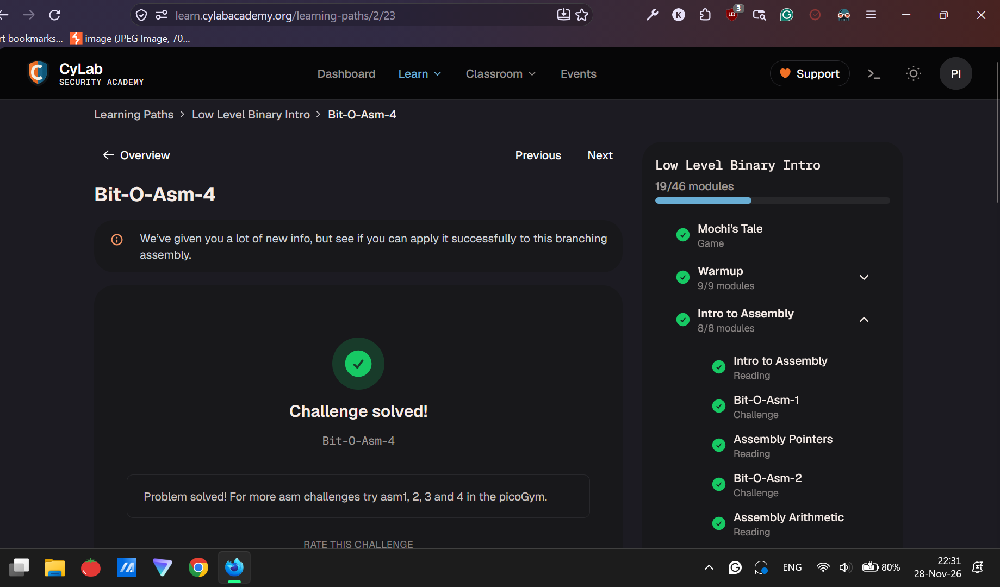

# 100DaysOfCode Twitter/X Challenge Round 5 (START: 22 November 2026, Sunday)
# Quote of This Round still the same: "Life is like riding a bicycle. To keep your balance, you must keep moving." -Albert Einstein.

#100DaysOfCode
R5D0:
- Busy competing onsite CTF jeopardy Finals competition today. It's incredibly hard, extremely hard for me.
- And also I write Write-Up for today's CTF competition.
- I have no idea for new round of 100DaysOfCode challenge lol.

#100DaysOfCode
R5D1:
- Today's week is an end-of-term exam week at my school
- So busy studying for end-term  exams tomorrow. Honestly, I got procrastinated a bit a lot.
- So sleepy and so exhausted right now for me.

#100DaysOfCode
R5D2:
- This week is an end-of-term exam week at my school, so I am busy studying for end-of-term exams tomorrow.
- Just showed up today by researching a CTF competition on Instagram. Or maybe I should research beyond just on IG.

#100DaysOfCode
R5D3:
- This week is an end-of-term exam week at my school.
- I am so busy studying or "cramming" for a tough end-of-term physics exam tomorrow. No way I can pass wkwkwkwk.
- Just showed up today by still doing researching a CTF competition on IG.

#100DaysOfCode
R5D4:
- This week is an end-of-term exam week at my high school.
- Deeply chilled right after taking a tough end-of-term Physics exam today lol.
- Self-studied Mandarin today, so I'm just showing up picoCTF by a little.

#100DaysOfCode
R5D5:
- I am really deeply tired and sleepy today. I really need to sleep earlier tonight.
- Researching CTFs (especially Jeopardy) through Instagram universities nationally vs Platform CTFtime or picoCTF. I think boths are good for me.
- Okay good night guys.

#100DaysOfCode
R5D6:
- Today I'm busy studying for the end-of-term Advanced Maths exam in two days. Really insanely hard bro.
- Just did a workout on the CyLab Security Academy REV/Pwn learning path.

